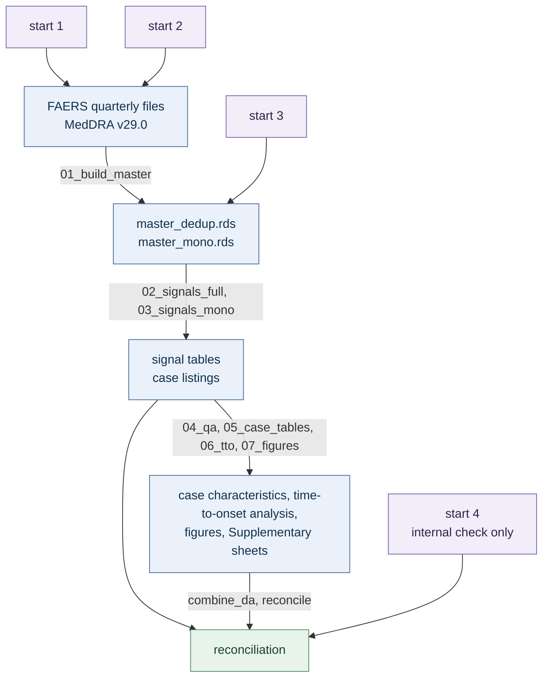

# SSRIs and lethal violence in the FDA Adverse Event Reporting System

Analysis code for:

> **Varia J, Nicholson T, Manookian L. A 22-year disproportionality analysis of SSRIs and lethal violence in the FDA Adverse Event Reporting System. Preprint. 2026. [PREPRINT DOI]**

## Introduction

- Reports were drawn from the FDA Adverse Event Reporting System (FAERS) for 2004 Q1 to 2025 Q4, extracted in May 2026.
- Only reports naming the drug or group under test as the primary suspect (PS) were counted.
- Adverse drug reaction (ADR) searches were grouped into two profiles of violence: externalizing and internalizing.
- Externalizing (homicidality) was defined by the preferred terms (PTs) homicide, aggression, homicidal ideation and violence-related symptom.
- Internalizing (suicidality) was defined by the PTs completed suicide, suicide attempt, suicidal ideation and intentional self-injury.
- Searches were run individually, pooled by group and as a composite where homicide and completed suicide were co-reported (H-S).
- Serotonin syndrome was included as an ADR benchmark for SSRIs.
- Six SSRIs were investigated: fluoxetine, citalopram, escitalopram, paroxetine, sertraline and fluvoxamine.
- Varenicline was included as a pharmacological benchmark for homicidal and suicidal profiles of violence.
- Two "reference sets" were applied for disproportionality analysis: all non-duplicated reports in FAERS (N = 19,687,141) and a set restricted to monopharmacy reports (N = 11,273,546).
- Four algorithms were applied: the Reporting Odds Ratio (ROR), Proportional Reporting Ratio (PRR), Multi-item Gamma Poisson Shrinker (MGPS, EBGM05) and Bayesian Confidence Propagation Neural Network (BCPNN, IC025).
- A signal was counted only where all four met their thresholds, and no estimate was reported for a pair resting on fewer than three cases.
- Time-to-onset was estimated by the Kaplan–Meier method, censored at one year.

## What is here

```
config.R               paths, study period, MCMC settings
run_all.R              runs every step in order
reconcile.R            the reconciliation checks
R/                     shared functions, no side effects
analysis/              the pipeline steps, 01 to 08
data/                  study definitions and manual corrections
tools/                 compare_to_reference.R, refit_ebgm_prior.R,
                       group_characteristics.R, build_si_globals.R,
                       new_cases_for_review.R, make_fig1.py, export_fig1.py,
                       update_expected.sh
expected_2004_2025/    expected output for the full study period
expected_2024_2025/    expected output for a two-year run
results/               where your own run goes; ships empty
```

| Script | What it does |
|---|---|
| [`01_build_master.R`](analysis/01_build_master.R) | Parse, standardize, deduplicate |
| [`02_signals_full.R`](analysis/02_signals_full.R) | Unrestricted signals |
| [`03_signals_mono.R`](analysis/03_signals_mono.R) | Monopharmacy signals |
| [`04_qa.R`](analysis/04_qa.R) | QA pairs |
| [`05_case_tables.R`](analysis/05_case_tables.R) | case characteristics, case listings |
| [`06_tto.R`](analysis/06_tto.R) | Time-to-onset analysis, Figure 5 |
| [`07_figures.R`](analysis/07_figures.R) | Figures 2 to 4 |
| [`08_rxnorm_lookups.R`](analysis/08_rxnorm_lookups.R) | RxNorm lookups, optional |
| [`combine_da.R`](combine_da.R) | Every estimate in one table |
| [`reconcile.R`](reconcile.R) | The reconciliation checks: every estimate recomputed from its own cells, nothing compared against another run |
| [`check_published.R`](check_published.R) | Shortcut: runs the two above over `expected_2004_2025/` |
| [`tools/compare_to_reference.R`](tools/compare_to_reference.R) | Compares your output against our run, value by value |
| [`tools/refit_ebgm_prior.R`](tools/refit_ebgm_prior.R) | Refits the MGPS prior from several starting values, to show they agree |

## Setting up

R 4.3 or newer.

```r
install.packages(c("data.table", "bit64", "ggplot2", "patchwork", "scales", "survival",
                   "remotes", "BiocManager"))
remotes::install_version("openEBGM", "0.9.1")
BiocManager::install("BiocParallel")
remotes::install_github("Yunuuuu/faers", ref = "3cc055c")   # 1.5.5, see below
remotes::install_version("rxref", "0.4.0")   # optional: step 08 only
```

Two versions are load-bearing. Use these:

- **`faers` 1.5.5** [4] — parsing, standardization and deduplication, which set every case count.
  Bioconductor now ships 1.8.0 and `BiocManager::install("faers")` will not return 1.5.5, which was
  a development-series version. Install it from source instead:
  `remotes::install_github("Yunuuuu/faers", ref = "3cc055c")` — the last commit to touch
  `R/dedup.R` at 1.5.5.
- **`openEBGM` 0.9.1** — the MGPS prior. Later releases shift EBGM05 on the low-count rows.

Figure 1 is the one figure R does not draw. `tools/make_fig1.py` writes the SVG and
`tools/export_fig1.py` renders it to PNG and EPS; between them they need Python 3 with
`cairosvg` and `Pillow`, `pdftops` from poppler-utils, and a metric-compatible Arial —
Liberation Sans on Linux. Neither is part of `run_all.R`, and both default to writing into
`expected_2004_2025/figures/`; run them only if you change the drawing.

```bash
pip install cairosvg pillow
sudo apt install poppler-utils fonts-liberation   # or your platform's equivalent
```

The input data go in one folder — `~/faers_data`, or set `FAERS_DATA_DIR`:

```
~/faers_data/
├── FAERS_ASCII/              faers_ascii_2004q1.zip, faers_ascii_2004q2.zip, ...
└── MedDRA_29_0_English/
    └── MedAscii/             llt.asc, pt.asc, hlt.asc, hlgt.asc, ...
```

- **FAERS** — the quarterly ASCII files into `FAERS_ASCII/`, zipped as downloaded. About 19 GB
  for the full period once unzipped [1].
- **MedDRA v29.0 English** — routes 1, 2 and 3, under your own license [2], unzipped so that `MedAscii/` sits
  directly inside `MedDRA_29_0_English/`. `llt.asc` and `pt.asc` are both read to map a
  reaction recorded at lowest level term to its preferred term. No MedDRA dictionary files are
  kept in this repository; the map is rebuilt at run time from your own distribution.
- **`master_dedup.rds` and `master_mono.rds`** — into `results/` inside the repository, not
  `~/faers_data`. Route 3 only, 4.4 GB [3].

The study definitions are CSV files in `data/`, not code:

| File | What it holds |
|---|---|
| `drug_dictionary.csv` | Generic, International Nonproprietary Name (INN), salt and brand terms per drug, by role: the six SSRIs, the benchmark drug and the QA pairs |
| `pt_definitions.csv` | The target preferred terms and their Homicidality or Suicidality grouping, plus serotonin syndrome, analyzed as an outcome in its own right, and ingrowing nail as a null check |
| `manual_dedup_blacklist.csv` | The 6,227 reports removed at manual review, with the reason for each |
| `blacklist_template.csv` | The same seven columns, empty, to compile your own |
| `non_drug_terms.csv` | Placeholders reporters write in the drug name field, and what is done with each |
| `mono_overrides.csv` | Two reports reclassified by hand as monopharmacy during development. The current counting rule already treats both as monopharmacy, so the overrides change no number; the reasons given in the file describe an earlier rule. Left unedited because the file is part of the definitions fingerprint (`PHV_DEF_HASH`) |
| `master_mono_stamp.txt` | The rule stamp the cached monopharmacy set must carry; step 01 rebuilds the set when it does not match |
| `master_nodrug_ids.txt` | The 10 reports that name no drug at all |
| `qa_pairs.csv` | The QA pairs expected to signal and the ROR floor each must clear. The two expected nulls are defined elsewhere — vitamin D in `drug_dictionary.csv`, ingrowing nail in `pt_definitions.csv` |
| `rxnorm_name_map.csv`, `rxnorm_class_map.csv` | Frozen RxNorm lookups for co-drug names and classes. Three Japanese brand names that RxNorm does not carry were matched to a similarly spelled ingredient and are corrected here, keyed `MANUAL::`: Mevalotin is pravastatin, Isomytal is amobarbital, and Neurotropin has no RxNorm ingredient and is left as recorded |

## Replication strategy

Four routes, from checking the numbers we published to rebuilding them from the raw files.


| Route | Start from | Needs | Compare against |
|---|---|---|---|
| **1** | raw FAERS, 2004–2025 | ASCII files [1] · ~19 GB unzipped · MedDRA [2] · ~128 GB RAM to run | `expected_2004_2025/` |
| **2** | raw FAERS, 2024–2025 | ASCII files [1] · ~3 GB unzipped · MedDRA [2] · ~32 GB RAM to run | `expected_2024_2025/` |
| **3** | our database | `master_dedup.rds` + `master_mono.rds` [3] · 4.4 GB to download · MedDRA [2] · ~128 GB RAM to run | `expected_2004_2025/` |
| **4** | our output | this repository | self-check |

Routes 1 and 2 run steps 01 to 07, then `tools/group_characteristics.R` and
`tools/build_si_globals.R`, and the two checks (`combine_da.R`, `reconcile.R`); route 3 runs
step 01 without the parse and then the same.

Routes 1 and 3 are memory-bound rather than CPU-bound: the combine, deduplication and MGPS
stages hold the whole database in memory, and route 3 fits the prior over the same matrix as
route 1 despite skipping the parse. Memory figures are approximate, and both need tens of GB
of scratch beyond the download. Route 4 reads published cells and runs anywhere.



### 1. Recompute 2004–2025 from the raw FAERS files

```bash
Rscript run_all.R && Rscript tools/compare_to_reference.R expected_2004_2025
```

### 2. Recompute 2024–2025 from the raw FAERS files

The whole pipeline end to end without the full 22-year download.

```bash
FAERS_START_YEAR=2024 FAERS_END_YEAR=2025 FAERS_RESULTS_DIR=two_year Rscript run_all.R &&
  Rscript tools/compare_to_reference.R expected_2024_2025 two_year
```

Only removal-list entries inside the window are found; the log says how many.

### 3. Recompute 2004–2025 from our database

Download `master_dedup.rds` and `master_mono.rds` (Zenodo, https://doi.org/10.5281/zenodo.23890223) into `results/`:

| File | Download | Size | SHA-256 |
|---|---|---|---|
| `master_dedup.rds` | [Download](https://zenodo.org/records/23890223/files/master_dedup.rds?download=1) | 3.17 GB | `00e3766939beb8851a13b02cf5efc46b4caf9cb5042b78922f5a4e5de893ab91` |
| `master_mono.rds` | [Download](https://zenodo.org/records/23890223/files/master_mono.rds?download=1) | 1.18 GB | `e769c276ce4c72f44cbab60a322e6950e0456eb822d41f291b91e6057e7cd069` |

```bash
mkdir -p results
cp <downloaded>/master_dedup.rds results/
cp <downloaded>/master_mono.rds  results/
cp expected_2004_2025/SI_DATA_COUNTS.csv results/     # already in this repository
cp data/master_mono_stamp.txt    results/             # ditto - see below
cp data/master_nodrug_ids.txt    results/
```

The last two are small text files kept here rather than on Zenodo, because they
describe the download rather than being part of it. `master_mono_stamp.txt`
records the definition `master_mono.rds` was built under, and step 01 rebuilds
the monopharmacy set from scratch unless it finds a stamp that matches the run
it is about to do - hours of work, and the reason to download the file in the
first place. `master_nodrug_ids.txt` lists the ten reports naming no drug at
all, which are excluded from the monopharmacy reference set and which step 01
reads rather than recomputing. They remain in the unrestricted set:
11,273,546 monopharmacy + 8,413,585 polypharmacy + 10 = 19,687,141.
Those are the counts after the 6,227 manual removals. The two .rds files are
written before the removal list is applied, so they hold 19,693,368 and
11,275,818 rows; step 02 removes the 6,227 on every run, of which 2,272
are monopharmacy.

Copy them by hand, as above. Step 01 deliberately does not fetch them itself:
a stamp placed beside a file it does not describe would certify the wrong data,
which is exactly what the stamp exists to prevent.

Check both files against their SHA-256 before running anything:

```bash
sha256sum results/master_dedup.rds results/master_mono.rds   # Linux; shasum -a 256 on macOS
```

```bash
Rscript run_all.R && Rscript tools/compare_to_reference.R expected_2004_2025
```

Step 01 skips the parse, so this needs no FAERS download. A MedDRA license is still required:
step 02 maps every reaction term to its preferred term and stops without `llt.asc` and `pt.asc`.

*Limitation:* the parse and deduplication are not rerun. Route 1 covers those.

### 4. Check that our published numbers add up

Nothing to download, nothing to license, and it runs on any machine in a few minutes. Two
scripts recalculate every published estimate and cross-check our files against one another:

```bash
Rscript combine_da.R expected_2004_2025 && Rscript reconcile.R expected_2004_2025
Rscript combine_da.R expected_2024_2025 && Rscript reconcile.R expected_2024_2025
```

In RStudio, open [`check_published.R`](check_published.R) and click Source — it runs those two
for you.

What is tested:

- Every ROR and PRR is recalculated from its four counts, and every EBGM05 from its counts and
  the published prior, and must match what we published. IC025 cannot be: it is a percentile of the MCMC posterior rather than a
  function of the four counts, so the IC point estimate is recalculated in its place and IC025
  itself is taken as published — one of the four consensus criteria is not independently
  checked this way.
- Each case list must contain exactly as many reports as the signal tables claim for it, and
  the case-characteristics total must be that same number.
- The six per-drug counts must sum to the pooled SSRI figure.

Both folders should end with `54 passed, 0 failed, 0 skipped`. **FAIL** is the number that
matters. A **SKIP** means a file that check needed is not in the folder, which happens if you
run this over a partial copy.

This route compares nothing against a second run — it is our own output tested against itself.
The same two scripts run at the end of routes 1 to 3, there over *your* output.

## Going further

Where the published numbers live, all in `expected_2004_2025/`:

| In the article | File |
|---|---|
| Database counts (SI “GLOBALS” first block, Fig. 1) | `summary_master.csv` |
| Figure 1 | `summary_master.csv`, `SI_DATA_COUNTS.csv`, and `SI_DATA_DA.csv` for the outcome counts — drawn by `tools/make_fig1.py`, which carries these counts as literals; check them against the three files if you re-run the pipeline, because the script does not read them |
| Figure 2 | `adr_indication_top20.csv` |
| Figures 3, 4 | `disproportionality_all.csv`, `fig3c_data.csv`, `fig4_data.csv` |
| Figure 5 | `SI_DATA_TTO.csv` |
| SI "DA" / "COUNTS" / "GLOBALS" / "TTO" | `SI_DATA_DA.csv` / `SI_DATA_COUNTS.csv` / `SI_DATA_GLOBALS.csv` / `SI_DATA_TTO.csv` |
| SI case lists | `SI_DATA_H_CASE_LIST.csv`, `SI_DATA_HS_CASE_LIST.csv` |
| SI “QA” | `qa_signals.csv`, `qa_supplementary.csv` |
| SI “SYMPTOM DOMAINS” | `symptom_domain_pts.csv` |
| SI “DRUG CLASSES” | `codrug_class_ingredients.csv`, `drug_class_summary.csv` |
| SI “DRUG” | `data/drug_dictionary.csv` — the one source outside `expected_2004_2025/` |
| SI “SUMMARY” | composed from the files above; it has no source file of its own |
| Reports behind every cell *a* | `cases_*.csv`; for the monopharmacy rows, filter those on `polypharmacy` |
| MGPS prior, each reference set | `ebgm_prior_full.csv`, `ebgm_prior_mono.csv` |

### The MGPS prior

Unlike the other three algorithms, MGPS is not a closed-form statistic computed from a single 2 × 2 table: its
gamma-mixture prior is a property of the whole reference set. It is fitted once per reference
set across the entire drug name × preferred term matrix, zero cells included, then held fixed
while every row is scored. Excluding those cells leaves one component unidentified. Components
are ordered by mean, larger first, as in DuMouchel [5].

`ebgm_prior_full.csv` and `ebgm_prior_mono.csv` record the hyperparameters and fit diagnostics.
`reconcile.R` recomputes every EBGM and EBGM05 from them and the published cells, so the column
can be checked without refitting. The fit is seeded and reproducible;
`tools/refit_ebgm_prior.R` reruns it from several starting values to show the likelihood has one
optimum.

### Quality assurance

Quality assurance (QA) drug–event pairs were run through the same pipeline as the SSRIs —
primary-suspect reports only, deduplicated, removal list applied — and recovered all six pairs
in `data/qa_pairs.csv` on large case counts, among them statin–rhabdomyolysis (ROR 45.88),
warfarin–haemorrhage (ROR 18.00) and ACE inhibitor–angioedema (ROR 110.78). The two expected
nulls, vitamin D and ingrowing nail, had too few cases for any estimate, so no signal. Full output in `qa_signals.csv` and
`qa_supplementary.csv`.

### Additional analyses

Each row of a case listing is a whole report:

| Column | What it holds |
|---|---|
| `all_pts` | every reaction term on the report |
| `all_drugs`, `codrug_names`, `n_codrugs` | every drug and the co-drugs |
| `polypharmacy` | `mono` or `poly` |
| `ssri_drug`, `drug_group`, `comparator_drug` | which drug, which group |
| `sex`, `age_in_years`, `reporter_country` | demographics |
| `event_dt`, `start_dt`, `fda_dt` | event, therapy start, FDA receipt |

- `all_pts` holds reaction terms as reported in FAERS, so a search of it is not the count — the
  listing's rows are.
- FAERS wrote them in capitals until 2012 Q3 and in mixed case from 2012 Q4, so the same term
  appears as `HOMICIDE` and `Homicide`. Use `ignore.case = TRUE`.
- Each term was mapped to its MedDRA preferred term, including those recorded at lowest level
  term — `MURDER` under `Homicide`, `SELF MUTILATION` under `Intentional self-injury`. Cell *a*
  counts them; a search of `all_pts` does not.
- Preferred terms keep MedDRA's own spelling throughout, which is British — `Haemorrhage`,
  `Dyspnoea`, `Abnormal behaviour` — whatever the spelling used elsewhere.
- The drug name field is free text, and reporters use it to say there was nothing to report.
  `data/non_drug_terms.csv` lists those placeholders. An entry stating that no co-medication
  was given ("NO CONCURRENT MEDICATION", "NONE") is dropped before drugs are counted, because
  it is not a drug. An entry naming an unidentified one ("UNKNOWN DRUG") is kept and counted
  as a co-drug, which holds the report out of monopharmacy — the conservative reading, since
  it can only shrink the monopharmacy set, never add to it.

### Using your own removal list

```bash
FAERS_BLACKLIST=my_removals.csv Rscript run_all.R
```

`data/manual_dedup_blacklist.csv` holds our 6,227 removals on three grounds —
`duplicate_report`, `implausible_date`, `serial_reporter` — with the retained counterpart,
where there is one, and the reasoning in the other four columns. Twenty rows have no counterpart:
the 17 implausible dates or ages, which were removed on their own grounds, and three reports whose
counterpart could not be identified at review. Yours needs the same seven columns and the same three `reason` values — copy
`data/blacklist_template.csv` to start. `reconcile.R` checks whichever list you supply. The list
cannot be empty: a file with no report IDs is rejected by step 02, so substitute your own
removals rather than none.

`how_identified` records how each removal was found. The counts below are of
`data/manual_dedup_blacklist.csv` itself and can be recounted from it:

| `how_identified` | n | What it means |
|---|---|---|
| `recorded at review` | 4,768 | Identified while reading the case list, one report at a time |
| `derived - rule 1` … `rule 5` | 1,260 | Identified by a matching rule applied across the case lists at review. 1,197 of these are described in `case_description` as same-quarter duplicates: two reports from the same quarter naming the same drug and the same reaction. 52 were raised by the duplicate-content flag below, and most of the remainder name the fields that matched (age, event date, start date). The rule numbers are the order the rules were applied in and carry no further meaning |
| `chain resolved` | 167 | The counterpart first identified was itself removed, so the retained report was traced through the chain |
| `not a duplicate - removed on its own grounds` | 17 | The implausible dates or ages |
| `repeat filing of one patient's case` | 12 | One patient's case filed separately by different manufacturers |
| `no counterpart found` | 3 | Judged a duplicate at review, retained report not identified |

Counting the whole file rather than the rule group, 1,204 of the 6,227 are described as
same-quarter duplicates.

The duplicate-content flag (`dup_content`) was set by the review-stage tooling, not by the
published pipeline. It marked candidates only and removed nothing.
It is separate from the automated deduplication in step 01, which is `faers::faers_dedup`:
that keeps the most recent version of each case, then treats two reports as one case only
where their drugs and their reactions match exactly and at most one of sex, age, reporting
country, event date, start date or indication differs.

### Rebuilding the database

Step 01 reuses `master_dedup.rds` if it is present; set `FORCE_REBUILD <- TRUE` in `config.R` to
redo the parse and deduplication. `fda_deletion_list_n` reads `NA` when the FDA's optional
quarterly deletion files are absent; no case was removed because of that list.

`combine_da.R` refuses to run on a part-finished pipeline; `FAERS_ALLOW_PARTIAL=TRUE` overrides
it, and `reconcile.R` then reports the gap.

## References

1. FDA. FAERS Quarterly Data Extract Files.
   https://fis.fda.gov/extensions/FPD-QDE-FAERS/FPD-QDE-FAERS.html
2. MedDRA Maintenance and Support Services Organization. MedDRA version 29.0, English.
   https://www.meddra.org
3. Varia J, Nicholson T, Manookian L. Deduplicated FAERS database for a 22-year
   disproportionality analysis of SSRIs and lethal violence, 2004 Q1 – 2025 Q4. Zenodo, 2026.
   https://doi.org/10.5281/zenodo.23691384
   (Concept DOI, as cited in the article: it always resolves to the newest version. The
   download table above deliberately uses the version DOI 10.5281/zenodo.23890223, which pins
   the two files whose SHA-256 it lists.)
4. Peng Y, Song Y, Qin C, Lin J. faers: R interface for FDA Adverse Event Reporting System.
   R package version 1.5.5, https://doi.org/10.18129/B9.bioc.faers
   https://bioconductor.org/packages/faers
5. DuMouchel W. Bayesian data mining in large frequency tables, with an application to the FDA
   spontaneous reporting system. The American Statistician. 1999;53(3):177–190.

## License

The code in this repository is released under the MIT license ([LICENSE](LICENSE)), and the
data files in `data/`, `expected_2004_2025/` and `expected_2024_2025/` are released under CC0
([LICENSE-DATA](LICENSE-DATA), https://creativecommons.org/publicdomain/zero/1.0/), with no
rights reserved.

If you use them, please give the following citation:

> Varia J, Nicholson T, Manookian L. A 22-year disproportionality analysis of SSRIs and lethal
> violence in the FDA Adverse Event Reporting System. Preprint. 2026. [PREPRINT DOI]

The code itself can be cited via `CITATION.cff`.

The underlying FAERS records are in the US public domain. No MedDRA dictionary files are
included: the outputs name MedDRA terms, as any FAERS analysis must, but the term map is
rebuilt at run time from your own licensed copy.

Questions about the code: research@healthfreedomdefense.org
